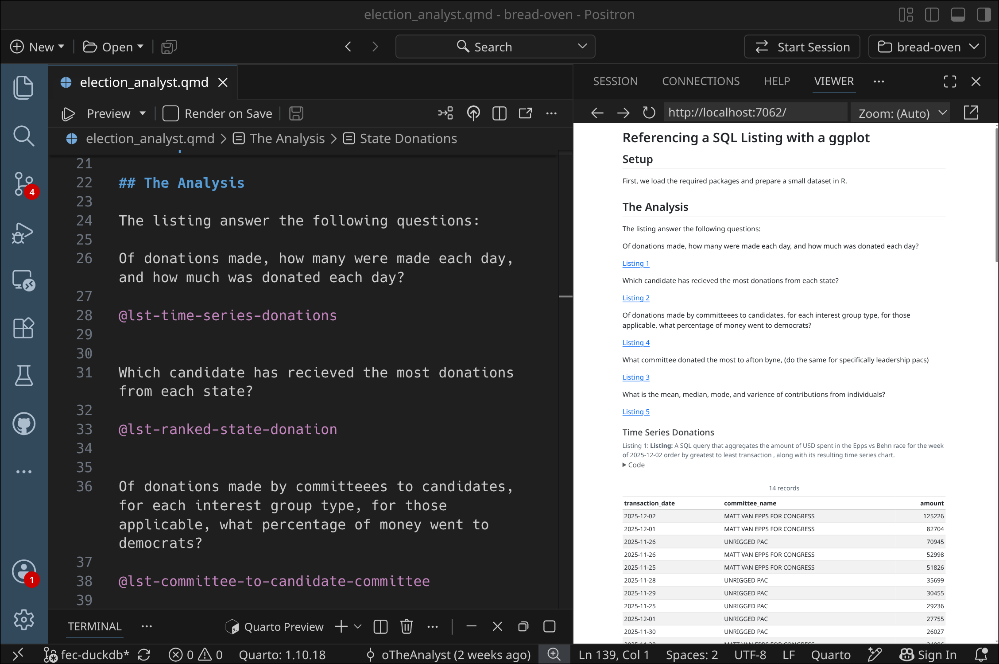
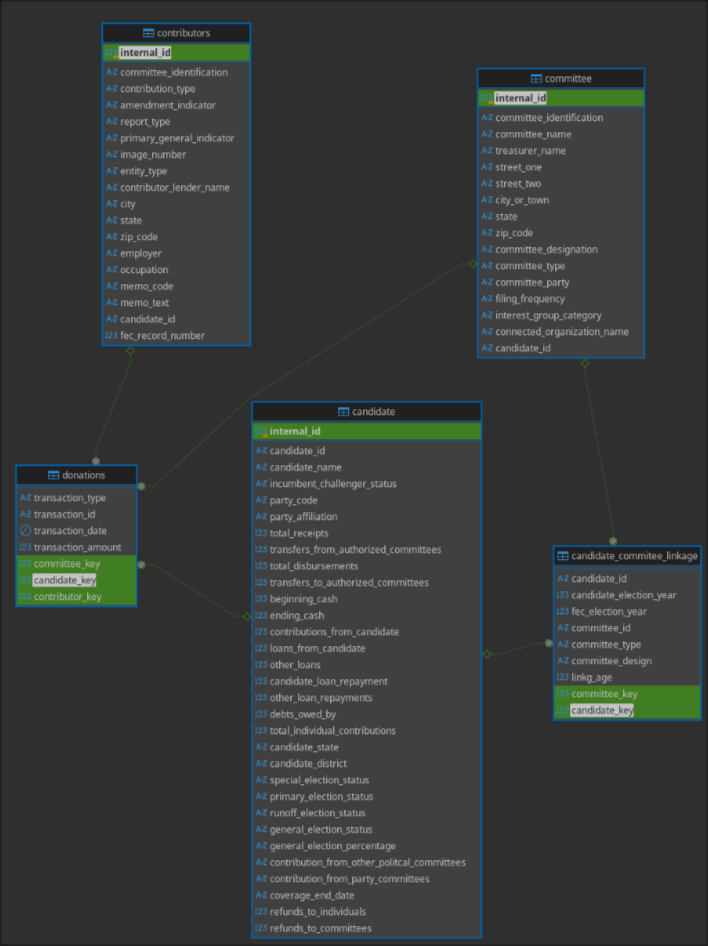

# What is this?

This is a dev shell for analysis of Federal Election Commmission data. 

The major components of this repo include:

- Reproducible duckdb database, for running performant analytical queries.

- Datapipeline that fetch data directly from the FEC, written in nix, which provides caching so database rebuilds won't download new data unless the data in FEC website has changed.

- Provides R, python, duckdb and versions of any corresponding package they use.

- Provides commands and programs to use in command line.


#### commands

- **sendb**: alias for `duckdb database.db` for ergonomic use of standardin `sendb < ./sql/ddb_sql/analysis/adhoc.sql` instead of `duckdb database.db < ./sql/ddb_sql/analysis/adhoc.sql`.

- **dbbuild**: builds out a database from cached data. data is downloaded and cached upon entering the devshell.

- ``quarto render election_analyst.qmd``: creates an html documnet from a .qmd. 

## dependencies 

You need install nixpkgs for this to work.

Add the following to `~/.config/nix/nix.conf` or `/etc/nix/nix.conf:`

``experimental-features = nix-command flakes``


## (Recommended) For the full repository 


This is the Partial Setup to just run the SQL based analysis: 
```nix
git clone git@github.com:oTheAnalyst/fec-duckdb.git

cd bread-oven

nix develop .

```



The full-shell provides quarto and Rduckdb which lets you render the qmd file and view the HTML in panes that are side by side.


## The ERD


 This database is built using a star schema on a type 1 SCD type.

 donations <-- fact_table
 candidate_committee_linkage <-- bridge table


## The File Structure 

The main directory of concern for user is the analysis folder, the rest is simply the build instructions.
```
.
├── election_analyst_files
│   ├── figure-html
│   └── libs
│       ├── bootstrap
│       ├── clipboard
│       └── quarto-html
│           └── tabsets
├── pics
└── sql
    ├── analysis
    ├── intemediate
    └── mart
```

